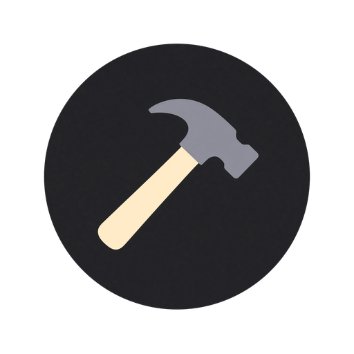
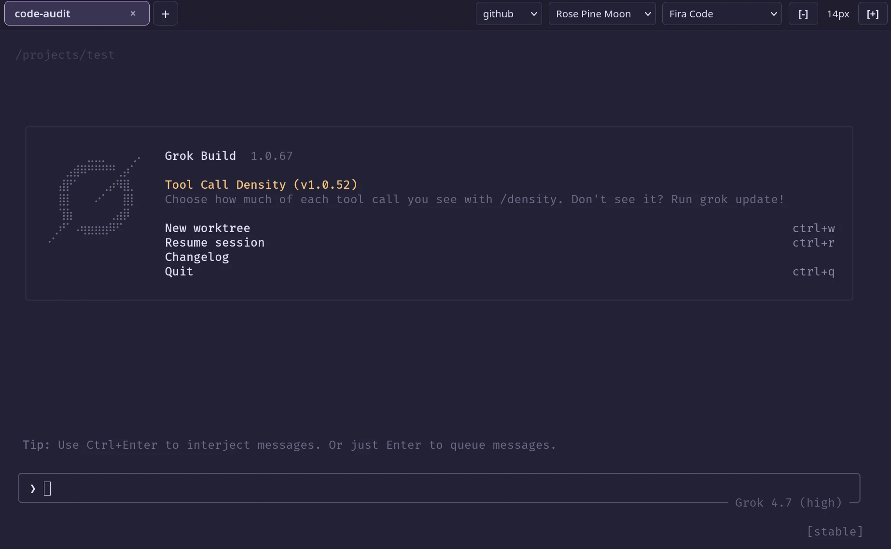

<div align="center">
  

  <h1>Grok Build Docker (Unofficial)</h1>

  [](https://www.gnu.org/licenses/gpl-3.0)
  [](https://github.com/yrmuq/grok-build-docker/pkgs/container/grok-build-docker)
</div>

---

> [!WARNING]
> **Unofficial Community Project:** This repository is an **unofficial**, community-maintained `Docker` environment and web terminal wrapper. It is **not** affiliated with, endorsed by, sponsored by, or officially connected to **xAI (X.AI Corp.)** or any of its subsidiaries.
>
> **No Proprietary Binaries Included:** This repository, its `Dockerfile`, and the published container image do **not** contain or distribute a `grok` binary. The official `grok` CLI is downloaded from `https://x.ai/cli/install.sh` onto the host volume `/core` during the container's first startup.

> [!NOTE]
> This project is in active development. Behavior can change, bugs may occur, and saved browser settings can become outdated.

---

A self-hosted `Docker` image and multi-tab web terminal for the `grok` coding agent. It keeps the agent, tools, and projects on host volumes, and serves the terminal with `ttyd`, `tmux`, and `xterm.js`.



---

## Features

* Persistent volumes for the agent home, installed tools, skills, projects, and the web terminal.
* Multi-tab terminal. Closing the browser detaches `tmux`; reopening restores sessions `chat0`, `chat1`, and so on.
* Terminal palettes, including `GrokNight` and `GrokDay`, synced with `/theme` inside `grok`. Fonts placed in `/terminal/fonts/` show up in the font menu.
* Non-root user `coder` (`UID:GID` `1000:1000`). `sudo` and `apt` are blocked. Tools install into `/utilities` with `mise`.
* UI language follows the browser, or a manual English / Russian choice, without reloading.

---

## Controls & Shortcuts

<details>
<summary>Controls</summary>

| Input | Action |
| :--- | :--- |
| Click `[+]` (Tab Bar) | Spawn a new `tmux` session tab. |
| Click Tab | Switch the active terminal session. |
| Double-Click Tab Name | Rename the active session tab. |
| Click `[×]` (Tab Bar) | Terminate the `tmux` session and close the tab. |
| Click `Reconnect` | Re-establish a dropped WebSocket connection. |
| Project Menu (`+`) | Prompt for a folder name, create it under `/projects`, and execute `cd` and `grok` if the active shell is idle. |
| Theme Selector / `/theme` | Switch color palettes with two-way synchronization. |
| Font Selector | Switch the terminal font. |
| Language Selector | `System`, English, or Russian. The change is immediate. |

`Ctrl+C` with no selection still interrupts `grok`.

</details>

---

## Installation & Usage

### Architecture & Format Support

| Architecture | Status |
| :--- | :---: |
| `x86_64` | ✅ |
| `arm64` | ✅ |
| `arm` (32-bit) | ❌ |

### Release Scheme

Stable releases are `X.Y.0`. A version `X.Y.Z` with `Z > 0` is an automatic dependency-update prerelease and is not the stable image. CI creates the git tag and the GitHub Release. No stable release has been published yet. The full list is the [GitHub releases](https://github.com/yrmuq/grok-build-docker/releases) page.

The image has two tags. `latest` is the stable image and moves only when a release is published from `main`. `dev` is the development image and moves on every push to `dev`. `dev` does not move `latest`.

### Docker

Create the host directories and give them to `1000:1000`:

```bash
mkdir -p docker/data/grok_build/{core,utilities,skills,projects,terminal}
sudo chown -R 1000:1000 docker/data/grok_build
```

`docker-compose.yml`:

```yaml
services:
  grok_build:
    container_name: grok_build
    image: ghcr.io/yrmuq/grok-build-docker:latest
    ports:
      - ${GROK_BUILD}:7681
    volumes:
      - ${LOCATION}/docker/data/grok_build/core:/core
      - ${LOCATION}/docker/data/grok_build/utilities:/utilities
      - ${LOCATION}/docker/data/grok_build/skills:/skills
      - ${LOCATION}/docker/data/grok_build/projects:/projects
      - ${LOCATION}/docker/data/grok_build/terminal:/terminal
    environment:
      - TZ=${GROK_TZ:-UTC}
      - USER=${GROK_USER:-admin}
      - PASSWORD=${GROK_PASSWORD:-}
    logging:
      driver: json-file
      options:
        max-size: "55m"
        max-file: "1"
    restart: unless-stopped
```

`.env`:

```dotenv
GROK_TZ=UTC
LOCATION=/path/to/data
GROK_USER=admin
GROK_PASSWORD=
GROK_BUILD=7681
```

Leave `GROK_PASSWORD` empty to disable login.

```bash
docker compose pull
docker compose up -d
```

Use `ghcr.io/yrmuq/grok-build-docker:dev` instead of `latest` to follow the development branch.

| Container Path | Purpose |
| :--- | :--- |
| `/core` | `GROK_HOME`: the `grok` binary, `auth.json`, `config.toml`, `AGENTS.md`, memory, and sessions. `gh` token files are `/core/gh`. Git identity is `/core/gitconfig`. |
| `/utilities` | Runtimes and CLI tools from `mise`, `cargo`, `rustup`, `uv`, and `npm`. |
| `/skills` | Custom skills (`/skills/<skill_name>/SKILL.md`), linked from `/core/skills`. |
| `/projects` | Default `WORKDIR` for repositories. |
| `/terminal` | Web UI (`index.html`), theme JSON, and fonts. A new image replaces `index.html` when its marker is missing, and replaces the shipped theme pack when its pack id changes. Other files you add stay. |

`docker compose pull` does not update the `grok` binary or the tools already installed under `/utilities`. Those live on the volumes. Update the agent with `grok update` inside the container. Install tools with `mise use -g <tool>@latest`.

#### Authentication & Usage

1. Open `http://<SERVER_IP>:7681`. If `GROK_PASSWORD` is set, sign in with `GROK_USER` and `GROK_PASSWORD`.
2. Sign in to `grok` with a subscription, using device authentication:

```bash
grok login --device-auth
```

3. Open the URL, enter the code, then start the agent:

```bash
grok
```

4. Install extra tools so they survive a new container:

```bash
mise use -g python@latest rust@latest go@latest gh@latest
```

`gh auth login` stores the token on `/core`. Log in again once after moving to an image that added that volume path, if an older token was only in the container home.

---

## License & Attribution

The scripts, `Dockerfile`, and web UI in this repository are licensed under `GPL-3.0-only`. See [LICENSE](LICENSE).

| Component | Upstream | License | Integration Details |
| --- | --- | --- | --- |
| `grok` (`grok-build`) | [xai-org/grok-build](https://github.com/xai-org/grok-build) | `Apache-2.0` | AI coding agent CLI downloaded to `/core` at runtime. Not baked into the image. |
| `ttyd` | [tsl0922/ttyd](https://github.com/tsl0922/ttyd) | `MIT` | Web terminal server. |
| `xterm.js` (+ `fit` and `web-links` addons) | [xtermjs/xterm.js](https://github.com/xtermjs/xterm.js) | `MIT` | Browser terminal, loaded from the CDN. |
| `tmux` | [tmux/tmux](https://github.com/tmux/tmux) | `ISC` | Terminal multiplexer. |
| `mise` (`mise-en-place`) | [jdx/mise](https://github.com/jdx/mise) | `MIT` | Runtime manager. Tools go to `/utilities`. |
| `Starship` | [starship/starship](https://github.com/starship/starship) | `ISC` | Shell prompt. |
| `JetBrains Mono` | [JetBrains/JetBrainsMono](https://github.com/JetBrains/JetBrainsMono) | `OFL-1.1` | Bundled font copied to `/terminal/fonts/`. |
| `Fira Code` | [tonsky/FiraCode](https://github.com/tonsky/FiraCode) | `OFL-1.1` | Bundled font copied to `/terminal/fonts/`. |
| `GrokNight` / `GrokDay` | [xai-org/grok-build](https://github.com/xai-org/grok-build) | `Apache-2.0` | Terminal palettes in `/terminal/themes/`. |
| `Tokyo Night` | [enkia/tokyo-night-vscode-theme](https://github.com/enkia/tokyo-night-vscode-theme) | `MIT` | Terminal palette in `/terminal/themes/`. |
| `Rosé Pine Moon` | [rose-pine/rose-pine-theme](https://github.com/rose-pine/rose-pine-theme) | `MIT` | Terminal palette in `/terminal/themes/`. |
| `Oscura Midnight` | [narative/oscura](https://github.com/narative/oscura) | `MIT` | Terminal palette in `/terminal/themes/`. |

*"Grok" and "xAI" are trademarks of X.AI Corp. All third-party trademarks and logos belong to their respective owners.*
