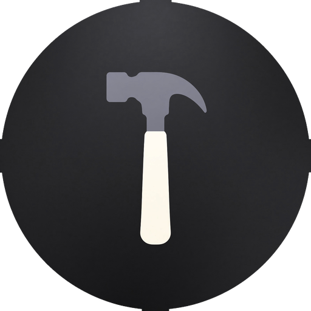
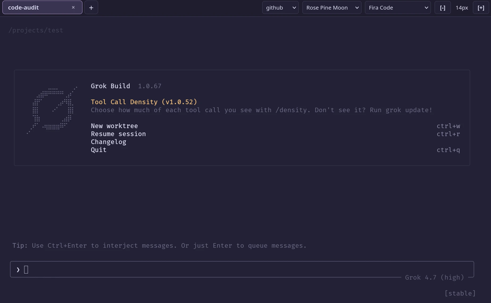

<p align="center">
  
</p>

# Grok Build Docker (Unofficial)

[](https://www.gnu.org/licenses/gpl-3.0)
[](https://hub.docker.com/_/ubuntu)

> **⚠️ DISCLAIMER: Unofficial Community Project**
> This repository is an **unofficial**, community-maintained Docker environment and web terminal wrapper. It is **not** affiliated with, endorsed by, sponsored by, or officially connected to **xAI (X.AI Corp.)** or any of its subsidiaries.
>
> **No Proprietary Binaries Included:** To strictly respect redistribution terms and upstream licensing, this repository and its `Dockerfile` do **not** contain or distribute any pre-packaged `grok-build` binaries. The official `grok` CLI is downloaded directly from `https://x.ai/cli/install.sh` onto your local host volume (`/core`) during the container's first startup.

---



## ✨ Features

* **Zero-Bloat Persistent Architecture:** Separated host-mounted directories for core agent binaries (`/core`), languages & CLI tools (`/utilities`), custom agent skills (`/skills`), and user workspaces (`/projects`).
* **Custom Multi-Tab Web UI (`/terminal/index.html`):**
  * Built on top of `ttyd`, `tmux`, and `xterm.js` — 100% mouse-driven top bar with no keyboard shortcuts required.
  * **Persistent Sessions:** Closing the browser tab detaches seamlessly; reopening restores all active `tmux` sessions (`chat0`, `chat1`, etc.) as browser tabs.
  * **Tab Management:** Click `[+]` to spawn a new session, click to switch, double-click the name to rename, click `[×]` to terminate, or click the `Reconnect` badge if a socket drops.
  * **Projects:** The menu to the left of the themes lists folders in `/projects`. `+` asks for a name, creates that folder, then runs `cd` and `grok` when the active tab is at the shell prompt.
  * **Live Theme & Font Switcher:** **GrokNight**, **GrokDay**, **Tokyo Night**, **Rose Pine Moon**, and **Oscura Midnight**. These are the same names Grok uses for `/theme`. Changing the menu updates the running Grok session, and `/theme` inside Grok updates the menu within a couple of seconds. Font family (**JetBrains Mono**, **Fira Code**, **System Monospace**) and font size stay in `localStorage`. Theme files live in `/terminal/themes/` and can be edited without rebuilding the image.
* **Sandboxed Package Management via `mise`:**
  * Runs as a non-root user (`coder`, `UID:GID 1000:1000`) with `sudo`, `apt`, and `apt-get` strictly blocked at runtime.
  * An `apt` wrapper redirects the AI agent to install all programming languages, compilers, and CLI tools directly into the persistent `/utilities` volume using **`mise`**.

---

## 📂 Directory Architecture

All stateful data lives outside the container image across 5 dedicated volumes:

| Container Path | Purpose |
| :--- | :--- |
| `/core` | `GROK_HOME` — stores the `grok` binary, OAuth tokens (`auth.json`), `config.toml`, `AGENTS.md`, memory, sessions, and git worktrees. |
| `/utilities` | Persistent storage for all runtimes and tools installed via `mise`, `cargo`, `rustup`, `uv`, and `npm`. Survives container rebuilds. |
| `/skills` | Custom Grok Build skills (`/skills/<skill_name>/SKILL.md`), automatically linked to `/core/skills`. |
| `/projects` | Default `WORKDIR` for your Git repositories and coding projects. |
| `/terminal` | The web UI (`index.html`) and theme JSON files. Edits apply on refresh. |

---

## 🚀 Quick Start (Docker Compose)

Create the persistent folders on your host with UID/GID `1000:1000`:

```bash
mkdir -p docker/data/grok_build/{core,utilities,skills,projects,terminal}
chown -R 1000:1000 docker/data/grok_build

```

Add the service to your `docker-compose.yml`:

```yaml
services:

  grok_build:
    container_name: grok_build
    build: https://github.com/yrmuq/grok-build-docker.git#main
    image: grok_build:latest
    ports:
      - ${GROK_BUILD}:7681
    volumes:
      - ${LOCATION}/docker/data/grok_build/core:/core
      - ${LOCATION}/docker/data/grok_build/utilities:/utilities
      - ${LOCATION}/docker/data/grok_build/skills:/skills
      - ${LOCATION}/docker/data/grok_build/projects:/projects
      - ${LOCATION}/docker/data/grok_build/terminal:/terminal
    environment:
      - TZ=${TZ}
      - USER=${USER}
      - PASSWORD=${PASSWORD}
    logging:
      driver: json-file
      options:
        max-size: "55m"
        max-file: "1"
    restart: unless-stopped

```

Create a companion `.env` file:

```dotenv
TZ=Europe/Tallinn
LOCATION=/home/user
USER=admin
PASSWORD=supersecretpassword
GROK_BUILD=7681

```

Start the container the first time (Compose builds the image because it is not on the machine yet):

```bash
docker compose up -d

```

After this repository changes, the old image is still named `grok_build:latest`. Rebuild it, then start:

```bash
docker compose up -d --build

```

Edits you make yourself in the mounted `/terminal` folder apply on a browser refresh. Those do not need `--build`.

---

## 🔑 Authentication & Usage

1. Open `http://<SERVER_IP>:7681` in your browser. Log in with `USER` and `PASSWORD` from your `.env`. If `PASSWORD` is empty, the page opens with no login.
2. Authenticate Grok Build using your xAI / X subscription via headless device auth:
```bash
grok login --device-auth

```


3. Open the displayed verification URL in your local browser, enter the code, and your session token will be saved permanently in `/core`.
4. Launch the agent inside any tab:
```bash
grok

```


5. To install additional languages or CLI utilities (either manually or by asking Grok in chat):
```bash
mise use -g python@latest rust@latest go@latest gh@latest

```

6. Update the CLI later with `grok update`. The binary stays on the `/core` volume.


---

## ⚖️ License & Third-Party Notices

### Repository License

The scripts, configuration files, `Dockerfile`, `entrypoint.sh`, `tab.sh`, and custom web interface (`index.html`) in this repository are licensed under the **GNU General Public License v3.0 (GPL-3.0)**. See the `LICENSE` file for full details.

### Third-Party Software & Attributions

This project integrates with or fetches the following third-party open-source and upstream tools during image build or runtime (each governed by its own respective license):

| Component | Purpose | License | Upstream Link |
| --- | --- | --- | --- |
| **Grok Build (`grok`)** | AI coding agent CLI (downloaded at runtime by the end user) | Apache-2.0 / xAI Terms of Service | https://github.com/xai-org/grok-build |
| **ttyd** | Web-based terminal server | MIT License | https://github.com/tsl0922/ttyd |
| **xterm.js** (+ Fit & WebLinks Addons) | Browser terminal emulator frontend (loaded via CDN) | MIT License | https://github.com/xtermjs/xterm.js |
| **tmux** | Terminal multiplexer for persistent sessions | ISC License | https://github.com/tmux/tmux |
| **mise (`mise-en-place`)** | Polyglot runtime and CLI tool manager | MIT License | https://github.com/jdx/mise |
| **Starship** | Cross-shell terminal prompt | ISC License | https://github.com/starship/starship |
| **JetBrains Mono** | Webfont loaded via CDN | SIL Open Font License 1.1 | https://github.com/JetBrains/JetBrainsMono |
| **Fira Code** | Webfont loaded via CDN | SIL Open Font License 1.1 | https://github.com/tonsky/FiraCode |
| **GrokNight / GrokDay** | Terminal palettes in `/terminal/themes/` | Apache-2.0 | https://github.com/xai-org/grok-build |
| **Tokyo Night** | Terminal palette | MIT License | https://github.com/enkia/tokyo-night-vscode-theme |
| **Rosé Pine Moon** | Terminal palette | MIT License | https://github.com/rose-pine/rose-pine-theme |
| **Oscura Midnight** | Terminal palette | MIT License | https://github.com/narative/oscura |

*"Grok" and "xAI" are trademarks of X.AI Corp. All third-party trademarks and logos belong to their respective owners.*
